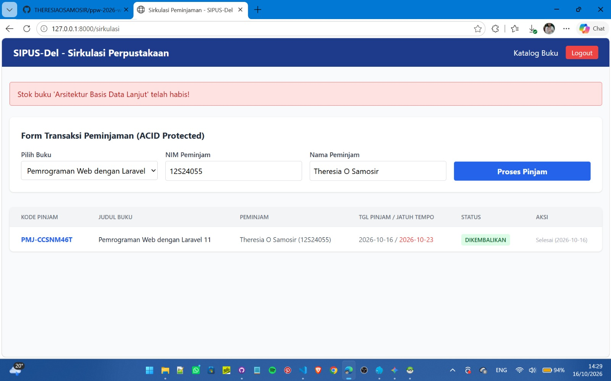
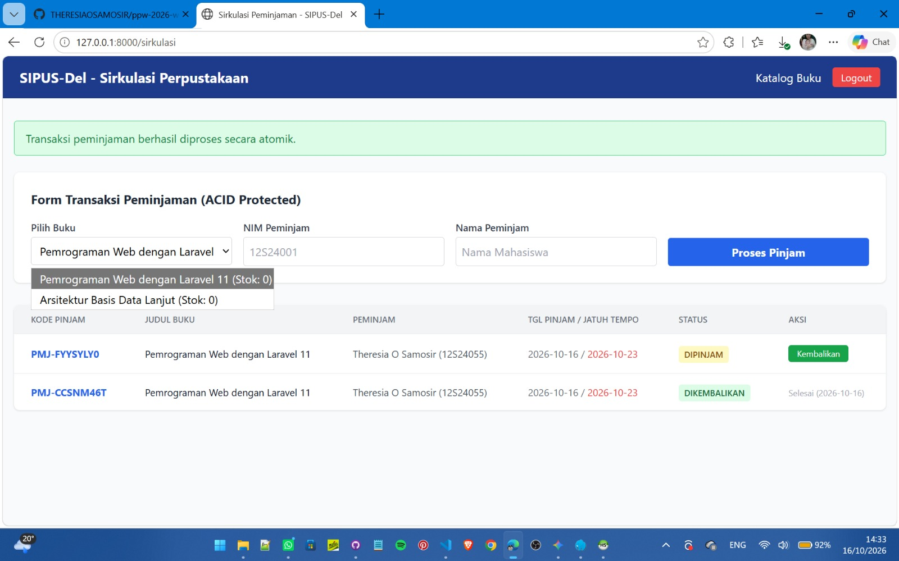
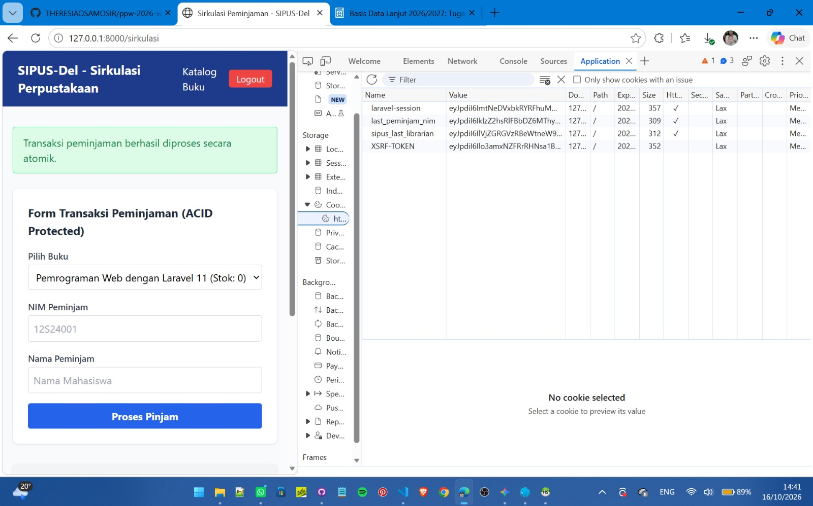

# SIPUS-Del (Sistem Informasi Perpustakaan Del) - Tahap 2

Proyek praktikum Pemrograman & Pengujian Web (PPW) Minggu 06 untuk mengembangkan modul sirkulasi peminjaman, autentikasi pustakawan, serta manajemen transaksi basis data ACID dengan penguncian baris (*pessimistic locking*).

---

## Ringkasan Fitur Utama

1. **Autentikasi Pustakawan & Keamanan Sesi**:
   - Proteksi rute dengan middleware `auth` dan regenerasi ID sesi untuk mencegah *Session Fixation*[cite: 6, 7].
   - Penggunaan Cookie berAtribut `HttpOnly` dan `SameSite=Lax` untuk mencegah ancaman pencurian sesi via XSS[cite: 2, 3].

2. **Sirkulasi Peminjaman & Transaksi ACID**:
   - Implementasi `DB::transaction()` dan penguncian baris `lockForUpdate()` untuk mencegah *race condition* stok buku[cite: 3, 5, 6].
   - Fitur otomatisasi status transaksi dan *rollback* ketika stok tidak mencukupi[cite: 3, 5, 6].

3. **Katalog & Analytics Perpustakaan**:
   - Rekapitulasi statistik menggunakan Fluent Query Builder (`DB::table`)[cite: 5, 6].
   - Agregasi relasi dengan `withCount('peminjamans')` pada katalog buku[cite: 5, 6].

---

## Laporan & Bukti Pengujian Praktikum Minggu 06

### 1. Pengujian Transaksi ACID & Pessimistic Locking (`lockForUpdate`)

#### A. Penolakan Peminjaman Saat Stok Buku Habis (Stok = 0)
Sistem melakukan penguncian baris (*pessimistic lock*) menggunakan `lockForUpdate()` di dalam transaksi `DB::transaction()`. Ketika stok buku 0, sistem melempar `RuntimeException` dan melakukan *rollback* otomatis sehingga transaksi dibatalkan secara aman[cite: 3, 5, 6].

#### B. Transaksi Peminjaman Berhasil (Stok > 0)
Saat stok tersedia, sistem mengurangi stok secara atomik dan mencatat histori sirkulasi peminjaman secara konsisten[cite: 3, 5, 6].

---

### 2. Audit Keamanan Sesi & Cookie (`HttpOnly`)

Berdasarkan hasil audit pada browser DevTools (Tab **Application** -> **Cookies**)[cite: 2, 7, 8]:
- **`laravel_session`**: Terkonfigurasi dengan atribut **`HttpOnly`** dan **`SameSite=Lax`** untuk mencegah ancaman serangan *Cross-Site Scripting* (XSS) dan *Cross-Site Request Forgery* (CSRF)[cite: 2, 3].
- **`sipus_last_librarian`** & **`last_peminjam_nim`**: Cookie penanda pustakawan dan peminjam yang dikirim via `Cookie::queue()`[cite: 5, 6].

